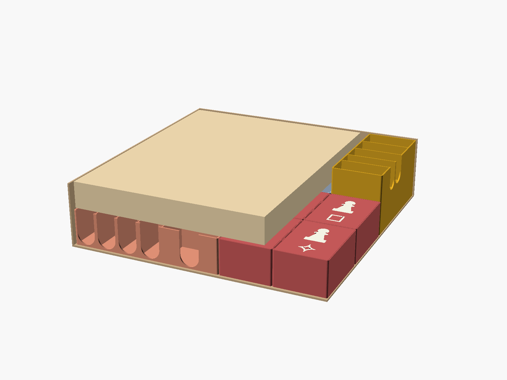
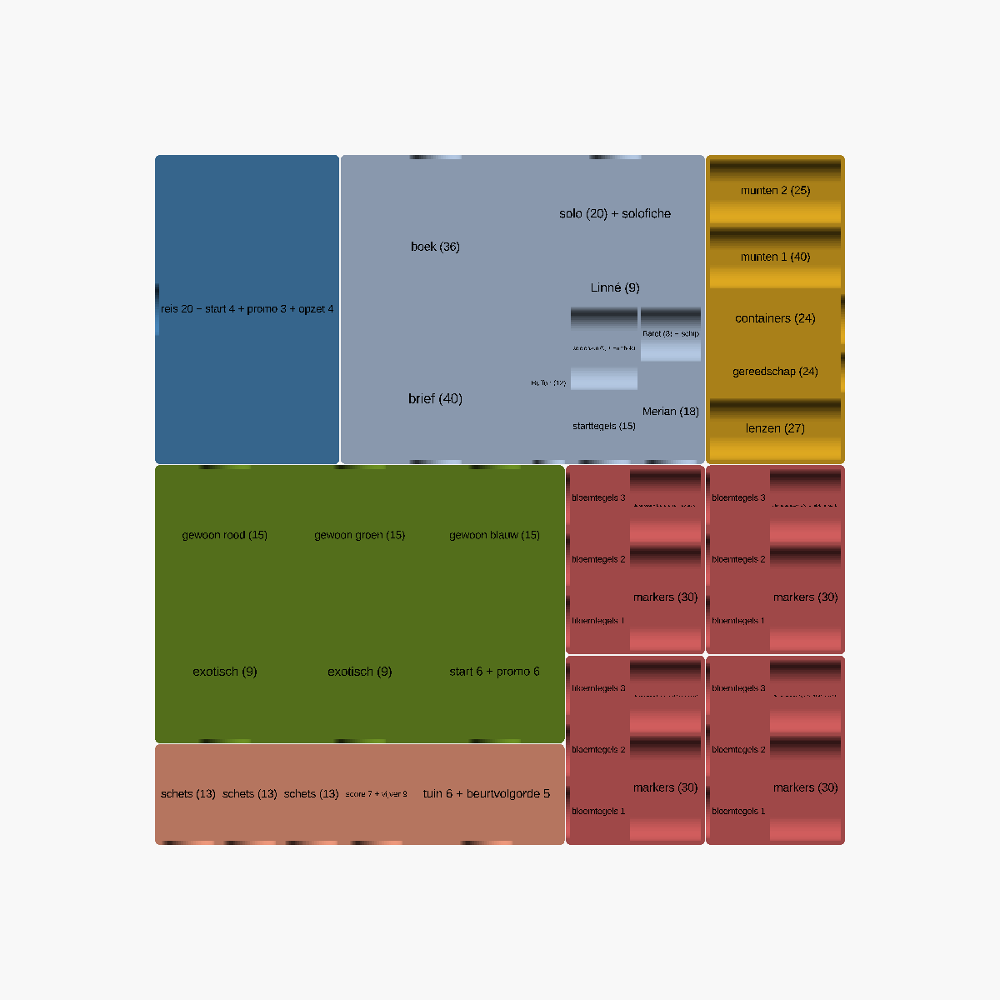
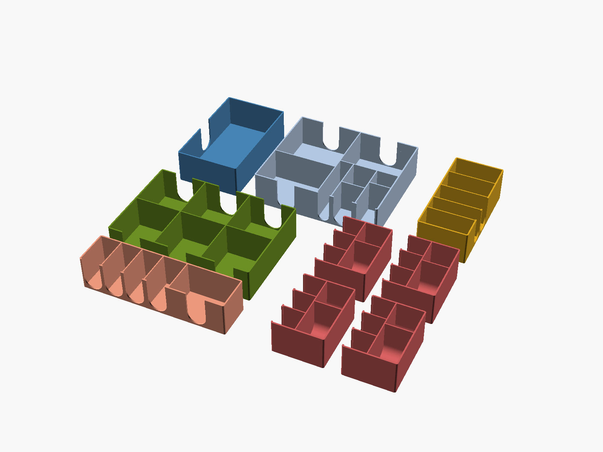

# Carl von Linné – eigen insert (3D-print)

**Versie 2 – op gemeten maten, alle kaarten in hoesjes.** Print eerst één spelersbakje als test.

## Idee

- **Alles op één hoogte (40 mm) onder de borden.** Speelbord, spelersborden, personageborden, overzichtskaarten en regelboek liggen er plat bovenop. Daardoor kan de doos ook rechtop staan zonder dat er iets door elkaar valt.
- **Elke kaartsoort in hoesje heeft een eigen vak**, met speling rondom en een vingergleuf.
- **Bakjes die je op tafel zet.** Elke speler krijgt een eigen bakje, de staaltegelbak is ook de trekbak.
- **Geen zakjes en geen verstopte laag.**
- **Alles past zich aan de maten aan.** Bovenaan in het bestand staan alle maten; de console toont na elke render een controle (OK / LET OP).

| Bakje | Aantal | Maat (mm) | Inhoud |
|---|---|---|---|
| A `kaarten_groot` | 1 | 77 × 129 × 40 | 31 reis-, start-, promo- en opzetkaarten |
| B `kaarten_klein` | 1 | 152 × 129 × 40 | boek, brief, solo; gevorderd spel (Buffon, Merian, Baret, Linné, Humboldt, sololenzen, starttegels); het roer ligt bovenop het solodeel |
| C `voorraad` | 1 | 58 × 129 × 40 | metalen munten 1 en 2, containers, gereedschap, 27 verbeterde lenzen |
| D `stalen` | 1 | 171 × 116 × 40 | 75 staaltegels in 6 vakken (trekbak) |
| E `tegels` | 1 | 171 × 42 × 40 | schets-, score-, vijver-, tuinbeloning- en beurtvolgordetegels |
| F–I `speler` | 4 | 58 × 79 × 40 | per speler: 3 stapels bloemtegels, markers, de rest van het hout |

De kartonnen munten gaan niet in de doos: je speelt met de 65 metalen munten.

Het grootste bakje is 171 mm: het past op de Bambu Lab A1 (256 mm).

## Printen

- PLA, nozzle 0,4 mm, laaghoogte 0,2 mm.
- Zet het aantal wanden op 4, zodat de buitenwanden van 1,6 mm massief zijn.
- Infill 15 %. Steunmateriaal is niet nodig: alle bakjes printen met de opening naar boven.
- Print eerst **één spelersbakje** als test en controleer of de bloemtegels, markers en de ontdekker erin passen.

## Bestanden

| Bestand | Wat |
|---|---|
| `carl-linne-insert.scad` | Het ontwerp. Open het in [OpenSCAD](https://openscad.org) (gratis). Onder *Window › Customizer* pas je de maten aan. |
| `stl/*.stl` | De bakjes, klaar voor de slicer |
| `render.sh` | Maakt alle STL's en afbeeldingen opnieuw (`OPENSCAD=pad/naar/openscad.com bash render.sh` op Windows) |
| `controle.echo` | Controlelijst: past alles (OK / LET OP)? |
| `fotos/` | Meetfoto's en het regelboek |
